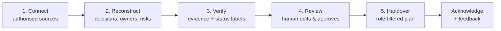
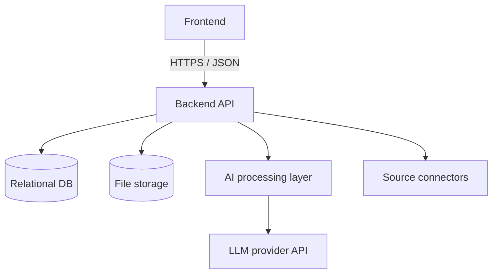

# Knowledge Handover Platform

> **Prevent critical knowledge from leaving with people.**
> An intelligence layer that turns scattered project activity into a traceable, reviewable, permission-aware handover.

 

> **Documentation status note:** Stack, routes and feature statuses in this documentation set are written as a *design target*. Items marked **VERIFY** must be checked against the repository and the status changed to *Implemented*, *Partially implemented*, *Planned* or *Not implemented* before submission. See [docs/FEATURES.md](docs/FEATURES.md).

## Table of Contents
1. [The Problem](#the-problem)
2. [Why It Matters](#why-it-matters)
3. [Our Solution](#our-solution)
4. [How It Works](#how-it-works)
5. [Core Features](#core-features)
6. [Differentiators](#differentiators)
7. [Architecture Overview](#architecture-overview)
8. [Technology Stack](#technology-stack)
9. [Screenshots](#screenshots)
10. [Installation and Local Development](#installation-and-local-development)
11. [Deployment Overview](#deployment-overview)
12. [Testing](#testing)
13. [Security and Privacy](#security-and-privacy)
14. [Roadmap](#roadmap)
15. [Team and Contributing](#team-and-contributing)

## The Problem
When someone leaves a project, what they know leaves with them. Documents exist, but the **reasoning and context** (why a decision was made, why a module is stuck, which API key expires when, who approves the budget) lives in chats, commits, issue comments, task boards and meeting notes.

## Why It Matters
| Who | Pain |
|---|---|
| Incoming member | Weeks of rediscovery, repeated mistakes, unclear priorities |
| Outgoing member | Rushed, shallow handover documents |
| Team lead | Cannot verify handover completeness |
| Organisation | Lost time and money; risk of leaking confidential material through careless handover |

## Our Solution
The platform sits **above** existing tools (GitHub, task boards, meeting notes, exported chats) rather than replacing them. It reconstructs project state from authorised sources, links every claim to evidence, flags uncertainty and contradictions, lets a human review and approve, and then shares a **role-appropriate** handover.

Plain AI summarisation fails because it hallucinates, cannot be checked, and leaks everything it was given. This platform is built to be **Traceable, Actionable and Permission-aware**.

## How It Works

Details: [docs/DATA_FLOW.md](docs/DATA_FLOW.md)

## Core Features
Full catalogue with status: [docs/FEATURES.md](docs/FEATURES.md)

- Source ingestion (GitHub, task board export, meeting notes, chat export)
- Structured extraction: decisions, tasks, owners, blockers, risks, dependencies, timeline, next actions
- Evidence links on every claim
- Human review, correction, approval and version history
- Role-based handover views with backend-enforced permissions
- Acknowledgement and feedback loop

## Differentiators
| # | Differentiator | Why it is not "just a summariser" | Status |
|---|---|---|---|
| 1 | Evidence Confidence Engine | Rule-based evidence status per claim, with the reason shown | VERIFY |
| 2 | Contradiction Ledger | Disagreeing sources are recorded, never silently resolved | VERIFY |
| 3 | Decision Archaeology | What / when / who / why / superseded-by for each decision | VERIFY |
| 4 | Role-Specific Knowledge Views | Permissions applied *before* retrieval and generation | VERIFY |
| 5 | Handover Readiness Assessment | Transparent, formula-based, not a quality claim | VERIFY |

## Architecture Overview

Full detail: [docs/SYSTEM_ARCHITECTURE.md](docs/SYSTEM_ARCHITECTURE.md)

## Technology Stack
> **VERIFY** and edit to match the repository. This is the proposed reference stack.

| Layer | Proposed |
|---|---|
| Frontend | React / Next.js |
| Backend | Python FastAPI (or Node/Express) |
| Database | PostgreSQL (optionally with pgvector) |
| Auth | JWT with role-based access control |
| AI | Hosted LLM API with structured JSON output |
| Sources | GitHub REST API, CSV/JSON task export, uploaded text/Markdown notes |

## Screenshots
> No screenshots committed yet. Add real screenshots to `docs/images/` and link them here. Do not use mock-ups presented as the real product.

| Screen | File |
|---|---|
| Project dashboard | `docs/images/dashboard.png` (placeholder) |
| Evidence view | `docs/images/evidence.png` (placeholder) |
| Contradiction Ledger | `docs/images/ledger.png` (placeholder) |
| Role-specific handover | `docs/images/handover.png` (placeholder) |

**Live demo:** _not deployed / add URL when available_

## Installation and Local Development
Quick path: [QUICKSTART.md](QUICKSTART.md). Environment variables: [docs/ENVIRONMENT_VARIABLES.md](docs/ENVIRONMENT_VARIABLES.md).

```bash
git clone <your-repo-url>
cd <repo-folder>
cp .env.example .env     # fill with your own values
# then follow QUICKSTART.md
```

**Demo credentials:** none documented. Only add them if seeded accounts actually exist and use synthetic data.

## Deployment Overview
See [docs/DEPLOYMENT.md](docs/DEPLOYMENT.md). No hosting provider is assumed.

## Testing
See [docs/TESTING.md](docs/TESTING.md). No test results are claimed in this repository documentation unless executed and recorded.

## Security and Privacy
See [SECURITY.md](SECURITY.md) and [docs/SECURITY_AND_PRIVACY.md](docs/SECURITY_AND_PRIVACY.md). Demo data must be synthetic, public or anonymised.

## Roadmap
See [docs/ROADMAP.md](docs/ROADMAP.md).

## Documentation Index
[Overview](docs/PROJECT_OVERVIEW.md) · [Architecture](docs/SYSTEM_ARCHITECTURE.md) · [Data flow](docs/DATA_FLOW.md) · [Schema](docs/DATABASE_SCHEMA.md) · [API](docs/API_DOCUMENTATION.md) · [AI pipeline](docs/AI_PIPELINE.md) · [Features](docs/FEATURES.md) · [Deployment](docs/DEPLOYMENT.md) · [Env vars](docs/ENVIRONMENT_VARIABLES.md) · [Testing](docs/TESTING.md) · [Security & privacy](docs/SECURITY_AND_PRIVACY.md) · [Demo guide](docs/DEMO_GUIDE.md) · [Roadmap](docs/ROADMAP.md) · [Technical decisions](docs/TECHNICAL_DECISIONS.md) · [Troubleshooting](docs/TROUBLESHOOTING.md)

## Team and Contributing
Team name: _<your team name>_

| Name | Role | Responsibility |
|---|---|---|
| _<full name>_ | _<role>_ | _<area>_ |

Contribution guidelines: [CONTRIBUTING.md](CONTRIBUTING.md) · [Code of Conduct](CODE_OF_CONDUCT.md)

## License
No licence has been selected yet. See [LICENSE](LICENSE).
