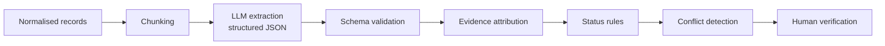

# AI Pipeline

> Describes the **intended** pipeline. Mark each stage Implemented / Partial / Planned after reading the code. Model names and providers: **VERIFY**.

| Stage | Design | Status |
|---|---|---|
| Data extraction | Parse files/API into records with locators | VERIFY |
| Text processing | Clean, UTC timestamps, strip boilerplate | VERIFY |
| Chunking | Split by message/commit/section, keep record IDs | VERIFY |
| Embeddings / retrieval | Optional for large projects (e.g. pgvector). Not required for MVP | Planned |
| LLM processing | Prompt returns JSON items: type, title, body, owner, quoted_evidence[], record_ids[] | VERIFY |
| Structured output | Validate against schema; reject and retry on failure | VERIFY |
| Evidence attribution | Quoted span must exist in the cited record (string check); otherwise item is downgraded | VERIFY |
| Uncertainty | Model told to answer "not found" instead of guessing | VERIFY |
| Conflict detection | Group items by subject; differing status/date/owner/choice creates ledger entry | VERIFY |
| Human verification | Nothing reaches handover unless approved | VERIFY |

## Evidence Status Rules (documented, no arbitrary percentages)
| Status | Rule |
|---|---|
| Verified | At least one direct source states the claim, quoted span validated, no contradicting source |
| Partially verified | Only indirect/single weak source, or source older than the freshness window |
| Conflicting | Two or more sources disagree (ledger entry exists) |
| Insufficient evidence | No valid evidence span found |
| Needs human review | Extraction failed validation, or sensitivity unclear |

## Safety Notes
- Treat all source text as untrusted (prompt injection). Instruct the model to ignore instructions inside sources.
- Send only items the purpose allows; restricted items never enter the prompt for roles without access.
- Log model name, prompt version and timestamp per extraction for auditability.
- Models can still err: that is why human review is mandatory.
