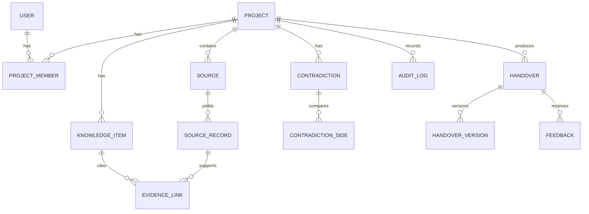

# Database Schema

> **Proposed schema.** Replace with the actual models (SQLAlchemy / Prisma / migrations) after inspection. Do not publish this as the real schema unless it matches.

| Table | Key fields | Notes |
|---|---|---|
| users | id, email (unique), password_hash, name | |
| projects | id, name, created_by | |
| project_members | project_id, user_id, role, handover_role | Unique (project_id, user_id) |
| sources | id, project_id, type, name, consent_by, scope | |
| source_records | id, source_id, author, timestamp, text, locator, sensitivity | Index (source_id, timestamp) |
| knowledge_items | id, project_id, type, title, body, owner, status, evidence_status, review_state, superseded_by, last_verified_at | type: decision/task/blocker/risk/dependency/action |
| evidence_links | item_id, record_id, span_start, span_end, relation | relation: supports/contradicts |
| contradictions | id, project_id, subject, resolution_status, resolved_by, rule_or_note | |
| contradiction_sides | contradiction_id, record_id, claim, timestamp | |
| handovers | id, project_id, from_user, to_user, role, state | |
| handover_versions | id, handover_id, version, content_json, approved_by, approved_at | Immutable once approved |
| feedback | id, handover_id, user_id, type, message | useful/incorrect/missing/clarify/correction |
| audit_logs | id, project_id, actor, action, target, at | |

Constraints: foreign keys with cascade rules by decision; check constraints on enum fields; index foreign keys and `(project_id, type)`.
