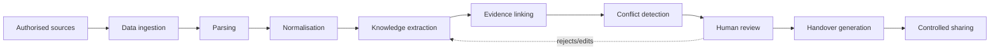

# Data Flow

| Stage | What happens | Key rule |
|---|---|---|
| Authorised sources | User connects/uploads only what they may share | Consent and scope recorded per source |
| Ingestion | Store raw file or fetched data; checksum; metadata | Validate type and size |
| Parsing | Extract text, timestamps, authors, IDs (commits, issue numbers, rows) | Keep original locations for citation |
| Normalisation | Common record: `source, author, timestamp, text, locator, sensitivity` | Preserve timestamps in UTC |
| Knowledge extraction | LLM returns structured items (decision, task, owner, blocker, risk, dependency, next action) as JSON | Schema-validated; no free-text-only output |
| Evidence linking | Each item stores references to exact source spans | Item without evidence becomes *Insufficient evidence* |
| Conflict detection | Compare items on same subject across sources (status, date, owner, choice) | Create a Contradiction Ledger entry; never auto-pick |
| Human review | Edit, confirm, reject, resolve conflicts | Every action versioned and audited |
| Handover generation | Built from **approved** items only | Role and sensitivity filter applied first |
| Controlled sharing | Incoming member views filtered handover; acknowledges | Access and acknowledgement logged |

Status of each stage in code: **VERIFY**. Related: [AI_PIPELINE.md](AI_PIPELINE.md).
