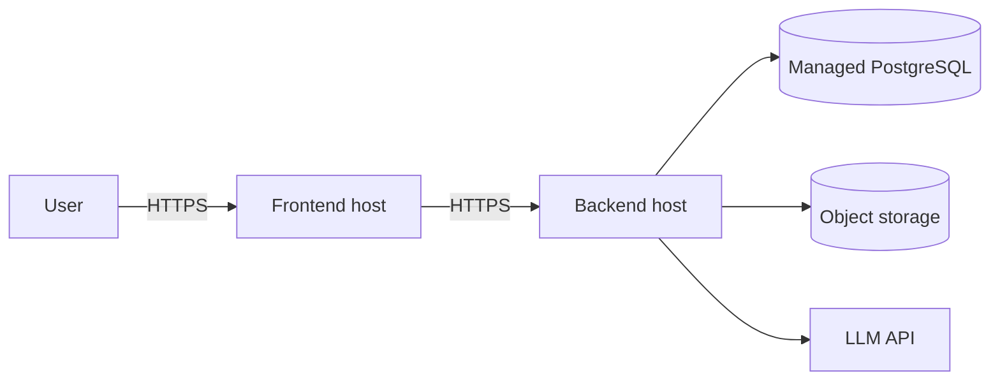

# Deployment Guide

> No hosting provider is assumed. Commands assume the proposed stack: **VERIFY** against actual scripts and config.

## Contents
Architecture · Environment · Database · Backend · Frontend · CORS & URLs · Storage · Health · HTTPS · Monitoring · Verification · Rollback

## Production Architecture


## Compatible Options (choose one)
| Part | Options |
|---|---|
| Frontend (Next.js/React) | Vercel, Netlify, any Node host |
| Backend (FastAPI/Node) | Render, Railway, Fly.io, container host |
| Database | Managed PostgreSQL (Neon, Supabase, Render, RDS) |

## 1. Database
Create a managed PostgreSQL instance; copy its connection string into `DATABASE_URL`. Run migrations:
```bash
alembic upgrade head          # or: npx prisma migrate deploy
```

## 2. Backend
```bash
pip install -r requirements.txt
uvicorn app.main:app --host 0.0.0.0 --port $PORT
```
Set variables from [ENVIRONMENT_VARIABLES.md](ENVIRONMENT_VARIABLES.md). Health check path: `/health`.

## 3. Frontend
```bash
npm ci && npm run build
npm run start
```
Set `NEXT_PUBLIC_API_URL=https://<backend-domain>`.

## 4. CORS and API URL
Backend `CORS_ORIGINS` must contain the exact frontend origin (scheme + host, no trailing slash). Frontend must point at the backend's HTTPS URL.

## 5. File Storage
Hosts with ephemeral disks lose local uploads. Use object storage (S3-compatible) or a persistent volume. **Planned** unless implemented.

## 6. Domain and HTTPS
Attach custom domains in the host dashboard; HTTPS is normally automatic. Redirect HTTP to HTTPS.

## 7. Logs and Monitoring
Use the host's log viewer; log request IDs; never log tokens, API keys or source text. Add uptime ping on `/health`.

## 8. Post-Deployment Verification
- [ ] `GET /health` returns ok
- [ ] Register/login works
- [ ] Create project, upload synthetic file, run analysis
- [ ] Incoming-role user cannot fetch restricted items (call API directly, not just UI)
- [ ] No CORS errors in browser console

## 9. Rollback
1. Redeploy the previous successful build from the host dashboard (or `git revert` and push).
2. If a migration was applied, run the down-migration only after taking a database backup.
3. Rotate any secret exposed during the incident.
4. Re-run the verification checklist.

## Docker (optional)
Add Docker only if the team needs reproducible environments; it is not assumed. If added, document the real `Dockerfile`/`docker-compose.yml` here.
