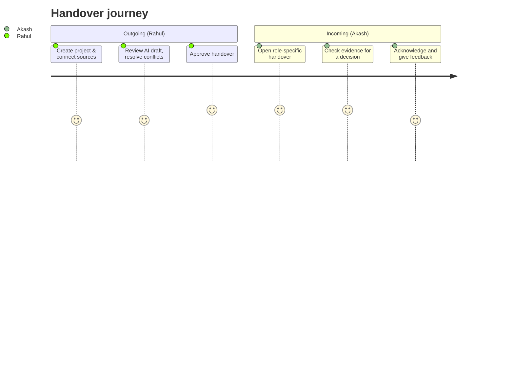

# Project Overview

## Contents
Problem · Users · Use case · Objectives · User journeys · Outcomes · Boundaries · MVP scope

## Problem Statement
Prevent critical knowledge from leaving with people. When a team member leaves, the reasoning, unfinished work, dependencies, recurring problems and contacts they carry are scattered across chats, repositories, task boards and meeting notes.

## Target Users
| User | Need |
|---|---|
| Incoming member | A trustworthy, prioritised "start here" handover |
| Outgoing member | Review an auto-generated draft instead of writing from scratch |
| Team lead / manager | Check completeness and approve |
| Organisation | Reduce loss; avoid leaking confidential data |

**Focused setting (recommended for scope):** student clubs / college project teams, with 2-3 source types (GitHub + task board + meeting notes).

## Real-World Use Case (illustrative, synthetic)
Rahul is leaving the backend developer role; Akash is taking over. Synthetic project facts: Login API completed; Payment integration in progress; Password reset pending; PostgreSQL selected; Payment webhook requires testing. A technical document says "payment integration completed" while the task export says "payment testing pending", so the platform records a contradiction instead of choosing silently.

## Main Objectives
1. Reconstruct project state from authorised sources.
2. Link every important claim to evidence.
3. Surface missing information and contradictions.
4. Keep a human in control (review, correct, approve).
5. Deliver role-appropriate handovers.
6. Log approval, versions and acknowledgement.

## User Journeys

## Expected Outcomes
Faster ramp-up, decisions traceable to source, flagged uncertainty, and an auditable handover record. No quantified claims (e.g. "saves 3 weeks") should be made unless measured.

## Product Boundaries
**In scope:** ingestion, extraction, evidence, conflict ledger, review/approval, role views, acknowledgement.
**Out of scope:** replacing GitHub/Jira/Slack, real-time monitoring, automatic task reassignment, HR decisions.

## MVP Scope
Prioritised five: Evidence Confidence Engine, Contradiction Ledger, Decision Archaeology, Role-Specific Views, Handover Readiness Assessment. See [FEATURES.md](FEATURES.md) and [ROADMAP.md](ROADMAP.md).
