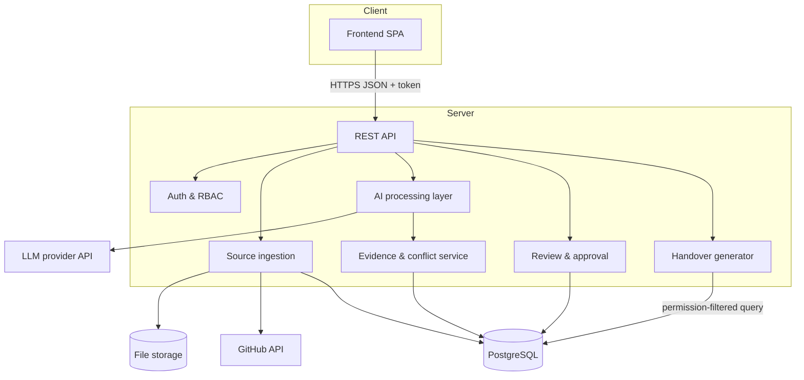

# System Architecture

> Proposed reference architecture. **VERIFY** component names against the repository.

## Contents
Overview · Components · Communication · External dependencies · Scalability

## Architecture Diagram

## Component Responsibilities
| Component | Responsibility | Status |
|---|---|---|
| Frontend | Project UI, evidence viewer, ledger, review screen, handover view | VERIFY |
| Backend API | Routes, validation, orchestration | VERIFY |
| Database | Projects, sources, items, evidence, conflicts, handovers, audit | VERIFY |
| Source ingestion | Upload/connect, parse, normalise, tag sensitivity | VERIFY |
| AI processing layer | Chunking, extraction prompts, structured output | VERIFY |
| Evidence management | Evidence links, status assignment, contradictions | VERIFY |
| Handover generation | Builds role-specific handover from approved items only | VERIFY |
| Review and approval | Edit/confirm/reject, versions | VERIFY |
| Permission-aware sharing | Filters by role and sensitivity before retrieval | VERIFY |

## Communication Flow
1. Frontend authenticates, stores token, sends it on each request.
2. Ingestion stores raw files and normalised records with permission scope.
3. AI layer reads only items the **requesting purpose** allows, extracts structured items.
4. Evidence service links each item to source spans and assigns status by rules.
5. Reviewer approves; approval freezes a handover version.
6. Incoming user requests handover; server filters by role before reading data.

## External Dependencies
LLM provider API, GitHub REST API (optional), hosting provider, managed PostgreSQL. All **VERIFY**.

## Scalability Considerations
Run extraction as background jobs (queue) rather than inside request cycles; cache normalised chunks; paginate evidence; index foreign keys; rate-limit LLM calls. Not implemented unless verified.

Related: [DATA_FLOW.md](DATA_FLOW.md) · [DATABASE_SCHEMA.md](DATABASE_SCHEMA.md)
