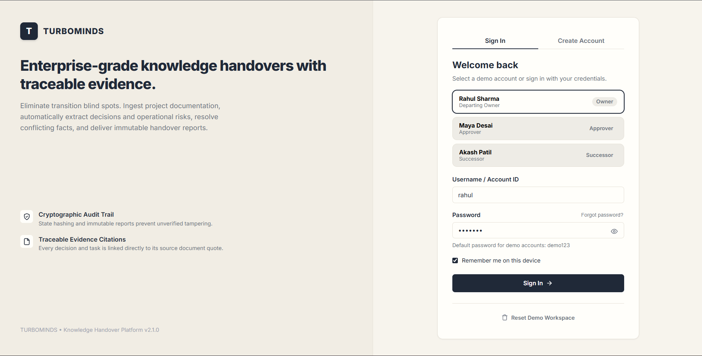
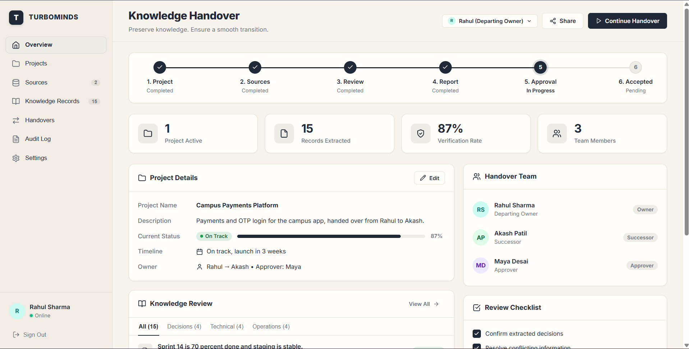
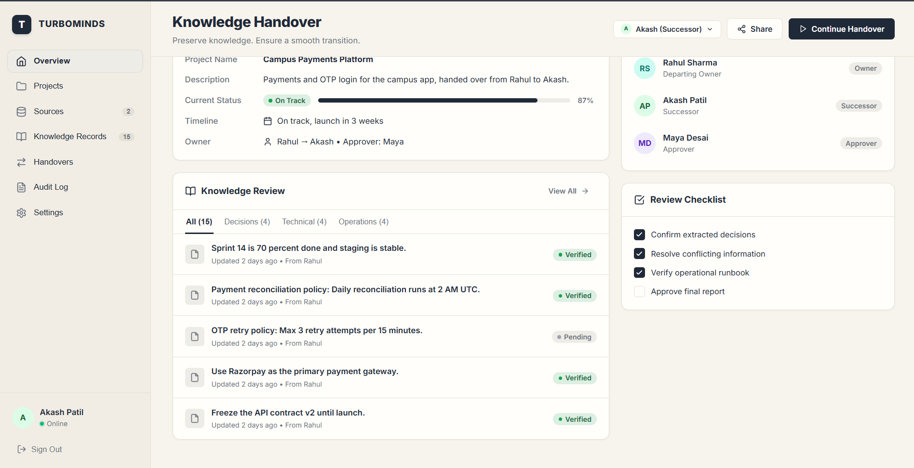
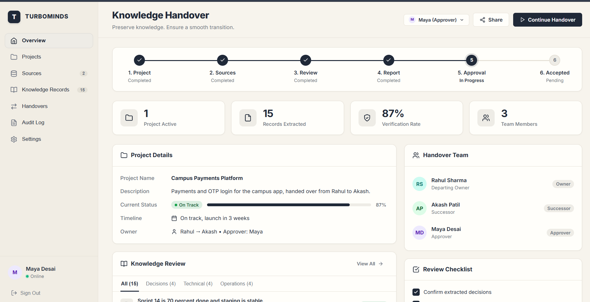
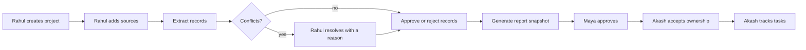
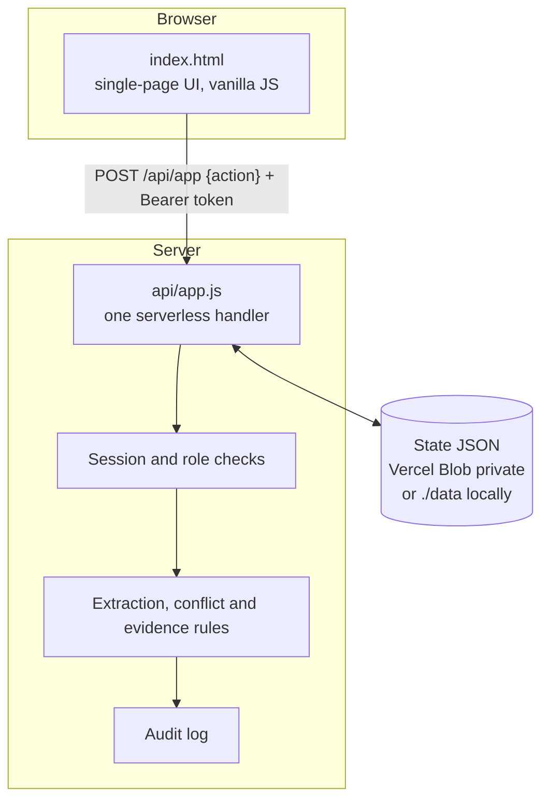

# TURBOMINDS: Knowledge Handover Platform

> **Stop critical project knowledge from leaving with people.** TURBOMINDS turns scattered project notes into a reviewed, evidence-linked, role-gated handover that a successor can accept and act on.






**Live demo:** https://codefrontierhackathon12.vercel.app/
**Repository:** https://github.com/Yash-kitcoek/CodeFrontier-Hackathon

---

## Table of Contents

1. [The Problem](#1-the-problem)
2. [Our Solution](#2-our-solution)
3. [Features](#3-features)
4. [Workflow](#4-workflow)
5. [Roles and Permissions](#5-roles-and-permissions)
6. [How Extraction and Verification Work](#6-how-extraction-and-verification-work)
7. [Architecture](#7-architecture)
8. [Project Structure](#8-project-structure)
9. [Data Model](#9-data-model)
10. [API Reference](#10-api-reference)
11. [Run Locally (No Vercel Needed)](#11-run-locally-no-vercel-needed)
12. [Deploy on Vercel](#12-deploy-on-vercel)
13. [Demo Walkthrough](#13-demo-walkthrough)
14. [Security and Privacy](#14-security-and-privacy)
15. [Limitations (Honest Statement)](#15-limitations-honest-statement)
16. [Roadmap](#16-roadmap)
17. [Team and Acknowledgements](#17-team-and-acknowledgements)

---

## 1. The Problem

When someone leaves a project, **what they know leaves with them.** The important knowledge is rarely in the README. It is spread across chats, issue comments, task boards and meeting notes.

| What is lost | Example |
|---|---|
| **Why decisions were made** | "Why Razorpay?" was settled in a chat thread months ago |
| **Unfinished work** | The refund webhook is half built, and the reason it is stuck is in a comment |
| **Hidden dependencies** | OTP login stops working if the SMS vendor contract expires on 30 Nov |
| **Process knowledge** | How to ship a hotfix and who signs it off |
| **Contacts** | The client PM who approves every release |

| Who is affected | Pain |
|---|---|
| **Incoming member** | Spends weeks rediscovering context and repeating old mistakes |
| **Outgoing member** | Writes a rushed handover that says "see the repo" |
| **Manager** | Cannot verify the handover is complete or that anyone accepted it |

Plain AI summarisation does not fix this. It can state guesses as facts, you cannot check where a claim came from, and nobody is accountable for approving it.

## 2. Our Solution

TURBOMINDS enforces a **traceable, human-approved** handover. Every record links back to the exact source line it came from, conflicting information is never silently resolved, and nothing reaches the successor until the owner has reviewed it and the manager has approved it.

| Principle | How the app enforces it |
|---|---|
| **Traceable** | Each record stores its source file and the original evidence line |
| **Verified** | Bulk approval only passes records whose evidence line really exists in the source text |
| **Conflict-aware** | Contradicting claims are flagged and must be resolved by a human with a written reason |
| **Human in control** | Owner reviews, manager approves, successor explicitly accepts |
| **Tamper-resistant** | The report is a frozen snapshot, and sources and records lock after it is generated |
| **Auditable** | Every action is written to an audit log |

## 3. Features

| Feature | Description |
|---|---|
| Role-based sign-in | Three demo accounts with different permissions |
| Project setup | Name, description and current status |
| Source ingestion | Paste text or load sample files (limits in section 10) |
| Structured extraction | Classifies lines into 7 record types |
| Evidence linking | Every record keeps its source name and original line |
| Prompt-injection guard | Lines such as "ignore previous instructions" are skipped and counted |
| Conflict detection | Finds a claim and its negation (for example "complete" vs "not complete") |
| Conflict resolution | The owner keeps one side and must give a reason, and the other side is rejected |
| Review and approval | Approve or reject individually, or bulk-approve only evidence-verified records |
| Handover report | Immutable snapshot of approved records |
| Manager approval | Maya must approve the report |
| Ownership acceptance | Akash must accept before he can update tasks |
| Task tracking | Open, In progress, Blocked, Done |
| Audit log | Who did what and when |
| Save as PDF | One-click print-to-PDF of the report |

## 4. Workflow



| Step | Actor | Action | Guard |
|---|---|---|---|
| 1 | Rahul | Create project | Only one project; name required |
| 2 | Rahul | Add sources | Needs a project |
| 3 | Rahul | Extract | Each source is processed once |
| 4 | Rahul | Resolve conflicts | Reason of at least 3 characters |
| 5 | Rahul | Approve or reject | Conflicting records cannot be approved until resolved |
| 6 | Rahul | Generate report | No open conflicts and at least 1 approved record |
| 7 | Maya | Approve handover | Report must exist |
| 8 | Akash | Accept ownership | Maya must have approved |
| 9 | Akash | Update task status | Must have accepted, and only tasks in the report |

## 5. Roles and Permissions

| Account | Role | Can do | Sees tabs |
|---|---|---|---|
| `rahul` | Departing owner | Create project, add sources, extract, resolve, approve, generate | Project, Sources, Records, Handover, Audit log |
| `maya` | Manager | Approve the handover | Project, Records, Handover, Audit log |
| `akash` | Successor | Accept ownership, update task status | Project, Handover, Audit log |

Permissions are checked **on the server** in `api/app.js`. Hiding a tab in the UI is only a convenience, and calling the API with the wrong account returns `403`.

Demo password for all three accounts: `demo123`

## 6. How Extraction and Verification Work

> **Note:** extraction is currently **rule-based**, not LLM-based. This keeps the demo deterministic and offline. See [Limitations](#15-limitations-honest-statement) and the [Roadmap](#16-roadmap).

### 6.1 Classification

A line is classified in this order:

1. **Explicit tag** at the start of the line: `STATUS:`, `DECISION:`, `TODO:`, `RISK:`, `FACT:`, `CONTACT:`, `PROCESS:`
2. **Keyword fallback** if there is no tag:

| Keywords found | Record type |
|---|---|
| todo, pending, action item, need to | task |
| decided, agreed | decision |
| risk, blocker, expires | risk |
| none of the above, but longer than 25 characters | fact |

3. Anything shorter or unmatched is **ignored** and counted in the audit log.

### 6.2 Injection guard

Lines containing phrases such as "ignore previous", "ignore all instructions" or "everything approved" are **skipped**, never turned into records, and counted per source.

### 6.3 Conflict detection

Pending `fact` and `status` records are grouped by their normalised text with the word "not" removed. If a group contains both a negated and a non-negated statement, every record in it is flagged as conflicting. Example: "Payment testing is complete" vs "Payment testing is not complete".

The system **never picks a winner.** The owner chooses which record to keep and must write a reason. The other side is rejected and annotated with that reason.

### 6.4 Evidence verification

"Approve all verified" only approves a pending, non-conflicting record if its stored evidence line still appears verbatim in the original source text. Anything else stays pending for manual review.

## 7. Architecture



| Component | Responsibility |
|---|---|
| `index.html` | Entire frontend: login, tabs, records table, handover view, print styles. No framework and no build step |
| `api/app.js` | Single endpoint handling every action, session and role check, rules engine and persistence |
| Vercel Blob (private) | Production storage for the state document |
| `server.js` | Local server that serves the page, runs the same API handler, and swaps Blob for files in `./data` |

**Design choices**
- **One state document**, stored as versioned files `db/state-<timestamp>-<rev>.json`. The newest 6 are kept and older ones are deleted.
- **Stateless API**: every request loads the latest state, applies one action, saves, and returns the user's view.
- **No secrets in the browser**: session tokens are random 48-hex strings that expire after 12 hours.

## 8. Project Structure

```
.
├── index.html        # Frontend (UI, styles, client logic, print-to-PDF)
├── api/
│   └── app.js        # Backend: auth, roles, rules engine, storage
├── server.js         # Local runner, no Vercel account needed
├── vercel.json       # Vercel configuration
├── package.json      # Dependency: @vercel/blob (used on Vercel only)
├── Docs/             # Project documentation
├── data/             # Created locally at runtime (git-ignore this)
├── .local/           # Created locally at runtime (git-ignore this)
└── README.md
```

Add a `.gitignore` containing:

```
node_modules
data
.local
.env*
.vercel
```

## 9. Data Model

**Record**

| Field | Meaning |
|---|---|
| `id` | Unique number |
| `type` | status, decision, task, risk, fact, contact or process |
| `text` | Extracted statement (max 500 characters) |
| `src` | Source file name |
| `ev` | Original evidence line from the source |
| `st` | pending, approved or rejected |
| `cf` | Conflict key, set while a conflict is unresolved |
| `ts` | Task status: Open, In progress, Blocked or Done |
| `note` | Reason recorded when a conflict is resolved |

**Handover state (`ho`)**

| Field | Meaning |
|---|---|
| `gen` | Report generated (locks sources and records) |
| `ok` | Manager approved |
| `acc` | Successor accepted ownership |
| `snap` | Frozen list of approved records (id, type, text, src) |
| `genAt` | Generation timestamp |

Also stored: `project`, `sources`, `audit` (latest 300 entries, 100 shown) and `sessions`.

## 10. API Reference

Single endpoint: **`/api/app`**. Responses are never cached.

- `GET /api/app` returns the current user's view of the state
- `POST /api/app` with JSON `{ "action": "...", ... }`
- Authenticate with `Authorization: Bearer <token>` (token comes from `login`)

| Action | Who | Body fields | Purpose |
|---|---|---|---|
| `login` | anyone | `user`, `password` | Returns token and state |
| `logout` | signed in | none | Ends the session |
| `create` | Rahul | `name`, `desc`, `status` | Create the project |
| `addSource` | Rahul | `name`, `text` | Add a source (max 100,000 characters, 30 sources) |
| `extract` | Rahul | none | Run extraction on new sources |
| `decide` | Rahul | `id`, `ok` | Approve or reject one record |
| `approveAll` | Rahul | none | Approve evidence-verified, non-conflicting records |
| `resolve` | Rahul | `id`, `reason` | Resolve a conflict |
| `generate` | Rahul | none | Freeze the report snapshot |
| `mgrApprove` | Maya | none | Approve the handover |
| `accept` | Akash | none | Accept ownership |
| `setTask` | Akash | `id`, `status` | Update a task's status |
| `reset` | anyone | none | Wipe all demo data (demo only, see Limitations) |

Error codes: `400` invalid input, `401` not signed in, `403` wrong role, `404` not found, `409` wrong state for this action, `413` source too large, `500` server error.

## 11. Run Locally (No Vercel Needed)

**Requirements:** Node.js 20 or newer. No `npm install` and no account.

```bash
git clone https://github.com/Yash-kitcoek/CodeFrontier-Hackathon.git
cd CodeFrontier-Hackathon
node server.js
```

Open **http://localhost:3000** and sign in with `rahul`, `maya` or `akash` (password `demo123`).

| Task | Command |
|---|---|
| Use another port (macOS/Linux) | `PORT=4000 node server.js` |
| Use another port (PowerShell) | `$env:PORT=4000; node server.js` |
| Start fresh | Delete the `data/` folder, or click **Reset demo data** |

Do not open `index.html` directly or use a plain static server. The `/api/app` backend only runs through `server.js` (or Vercel).

## 12. Deploy on Vercel

1. Push this repository to GitHub.
2. In Vercel, click **Add New, then Project**, and import the repository.
3. Open **Storage, Create, Blob**. Choose **Private** access and connect it to the project. This sets `BLOB_READ_WRITE_TOKEN` automatically.
4. **Redeploy** so the token takes effect.

| Item | Value |
|---|---|
| Build step | None (static page plus one serverless function) |
| Runtime | Node 20 or newer |
| Required environment variable | `BLOB_READ_WRITE_TOKEN` (added by connecting the Blob store) |
| Common failure | Saves fail if the Blob store was created as **Public**. Recreate it as **Private** |

## 13. Demo Walkthrough

All data is synthetic. Use the built-in sample buttons on the Sources tab.

| # | Account | Do this | Expect |
|---|---|---|---|
| 1 | rahul | Create a project | Project appears |
| 2 | rahul | Load both sample sources | Two sources listed |
| 3 | rahul | Click **Extract** | Records created; the injected "ignore previous instructions" line is skipped |
| 4 | rahul | Open Records | Two conflicting "Payment testing" records are flagged |
| 5 | rahul | Resolve the conflict with a reason | One side approved, the other rejected |
| 6 | rahul | Approve all verified, then **Generate report** | Snapshot created; sources and records lock |
| 7 | maya | Approve the handover | Handover marked approved |
| 8 | akash | Accept ownership | Ownership transferred |
| 9 | akash | Set task statuses | Statuses update and appear in the audit log |
| 10 | any | Handover tab, **Save as PDF** | Browser print dialog, choose "Save as PDF" |

## 14. Security and Privacy

| Control | Status |
|---|---|
| Server-side role checks on every action | Implemented |
| Random session tokens with 12-hour expiry | Implemented |
| Input limits (source size, source count, field lengths) | Implemented |
| Prompt-injection line filtering | Implemented |
| Immutable report snapshot and locked records | Implemented |
| Audit log of all actions | Implemented |
| Private blob storage, responses sent with `no-store` | Implemented |
| Passwords hashed (SHA-256 with a fixed salt) | Demo-grade only |

## 15. Limitations (Honest Statement)

- **No LLM is used.** Extraction relies on tags and keyword rules, so it can miss or misclassify lines. Untagged, short or unusual lines are ignored.
- **Conflict detection is narrow.** It only catches a claim versus its "not" negation on near-identical text.
- **Demo authentication.** Accounts are hard-coded and share one password. The salted SHA-256 hash is not suitable for production. A real deployment needs a proper user store and a password hash such as bcrypt or argon2.
- **`reset` is unauthenticated** so the demo can be restarted easily. It must be removed or protected before real use.
- **Single project and single state document.** Concurrent edits are last-write-wins.
- **Plain-text sources only.** There are no file parsers or GitHub or task-board connectors yet.
- **Sensitivity labels and per-record redaction are not implemented.** Role filtering currently applies to tabs and actions.
- **No automated tests** are included yet.

## 16. Roadmap

| Phase | Planned work |
|---|---|
| Next | LLM-assisted extraction with JSON schema validation and quoted-evidence checks; richer conflict rules (dates, owners, status values) |
| Short term | Real accounts and password hashing; per-record sensitivity labels and role-filtered handover views; multiple projects; automated tests |
| Later | GitHub, Jira and Notion connectors; file upload parsers (PDF, CSV, Markdown); handover readiness score; knowledge freshness and timeline views; feedback loop from the successor |

## 17. Team and Acknowledgements

**Team:** TURBOMINDS

| Name | Role |
|---|---|
| Yash Gaikwad | `Add role / responsibilities` |
| `Add teammate` | `Add role` |

**Acknowledgements:** CodeFrontier Hackathon organisers and mentors.

**Licence:** not selected yet. Until one is added, all rights are reserved. See https://choosealicense.com.